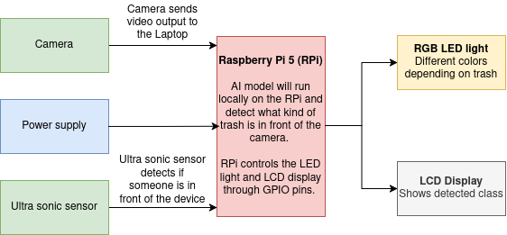

# Project Definition (PD) — P1 CTAI

---

## 1. Project identity

| Field                | Your answer                  |
| -------------------- | ---------------------------- |
| **Working title**    | The Self-sorting Bin         |
| **Student name**     | Adam Persson                 |
| **Sparring partner** | Carl Jonsson                 |
| **Project type**     | [x] Vision                   |

---

## 2. Concept & impact

| Topic            | Your answer                                                                                                                                                                                                                                      |
| ---------------- | ------------------------------------------------------------------------------------------------------------------------------------------------------------------------------------------------------------------------------------------------ |
| **Objective**    | Develop a working AI prototype for automatically sorting waste.                                                                                                                                                                                   |
| **Target group** | People in public areas, malls, schools, stadiums, and parks.                                                                                                                                                                                     |
| **Core problem** | Many people do not sort their waste as much as needed, especially because it can be time-consuming, unclear, and inconvenient. Recycling rules may be unclear and sometimes people do not have time to spend on waste sorting.                    |
| **Key question** | How can waste sorting be made more convenient, and thus more common, to contribute even more to improving the environment?                                                                                                                        |
| **Impact**       | Individuals will benefit from a more convenient way of waste sorting. The environment will benefit from decreased pollution. Communities and society will benefit from increased recycling.                                                        |

---

## 3. AI & data pipeline

### 3A. Method & data

> **Note:** Standard **image classification only** (single label per image, no boxes/keypoints) is **not allowed**.

| Requirement                    | Your answer                                                                                                                                                                                                                                                                           |
| ------------------------------ | ------------------------------------------------------------------------------------------------------------------------------------------------------------------------------------------------------------------------------------------------------------------------------------- |
| **Dataset — how & where**      | Photos will be taken of objects typically thrown in the trash. Pictures are taken from an above perspective with a bright background — matching the final prototype's identification conditions. Objects will be photographed from all six sides, under 5 colour temperatures and 4 different brightness levels using an LED light. |
| **Classes (min. 4, target 6)** | 1. Plastic bottles 2. Plastic packages 3. Metal cans 4. Paper/cardboard 5. Glass jars 6. Organic (food waste)                                                                                                                                                                         |
| **Volume**                     | ≥ 100 annotations per class planned — objects rotated across all axes per class                                                                                                                                                                                                       |

### 3B. Training & export

| Project type | Your choice & model                            |
| ------------ | ---------------------------------------------- |
| **Vision**   | YOLO26n — lightweight, designed to run well on Raspberry Pi |

| Topic                    | Your answer                                                                                                  |
| ------------------------ | ------------------------------------------------------------------------------------------------------------ |
| **Training environment** | [x] Laptop — local PC                                                                                        |
| **Export to RPi**        | Trained model is exported and run locally on the Raspberry Pi                                                |

---

## 4. Hardware & Makerlab plan

### 4A. Mandatory hardware

| Requirement                       | Your implementation                                                                                                                                                               |
| --------------------------------- | --------------------------------------------------------------------------------------------------------------------------------------------------------------------------------- |
| **Headless-first**                | [x] Physical button start/stop — device turns on/off with a button press; enters stand-by mode until a person is detected via ultrasonic sensor                                   |
| **Visual feedback (mandatory)**   | LED display — shows feedback about the class identified by the model                                                                                                              |
| **Hardware feedback (mandatory)** | RGB LED light — different colours correspond to different bins, indicating where the user should throw their trash                                                                 |
| **Extra sensor or actuator**      | Ultrasonic sensor — detects when a person approaches the bin; wakes the system from stand-by mode when a person is within a certain distance                                      |

### 4B. Build quality (Makerlab)

| Criterion            | Your plan                                                                                                                                                                                          |
| -------------------- | -------------------------------------------------------------------------------------------------------------------------------------------------------------------------------------------------- |
| **Housing**          | Laser-cut wooden box containing the Raspberry Pi, on/off button, ultrasonic sensor, LED display, and RGB LED light (sensor, display, and RGB light face forward toward the user). Flat surface for placing trash on top; stand to elevate the camera. |
| **Cable management** | Wires kept inside the enclosure (except the power cord); internal cables managed with cable management strips                                                                                       |
| **Safety**           | Only necessary components (the display and the RGB light) are somewhat exposed to the user; no exposed electronics otherwise                                                                        |
| **Aesthetics**       | Clean laser-cut wooden enclosure with a clear, functional layout; components intentionally positioned facing the user                                                                               |

---

## 5. Software & visualisation

### 5A. Gradio interface (mandatory pages)

| Page                   | Content you will show                                                                                                                                                                                                                                                                                         |
| ---------------------- | ------------------------------------------------------------------------------------------------------------------------------------------------------------------------------------------------------------------------------------------------------------------------------------------------------------- |
| **About & onboarding** | Project info and instructions: proximity requirement to wake device from stand-by, where to place trash for correct identification, LED colour meaning per bin, and a guide to the other Gradio pages                                                                                                           |
| **Data**               | Real-time ultrasonic sensor readings, real-time model detections with confidence scores, and statistics about how frequently different classes are detected                                                                                                                                                    |
| **Operating**          | Remote system shut-down, ability to delete sessions and detections from the database                                                                                                                                                                                                                           |
| **Debugging**          | Hardware component testing: write text to the LCD display, control RGB light colour via three sliders (R/G/B), view error messages and logs                                                                                                                                                                    |

### 5B. Backend & data

| Component    | Your answer                                                                                                                                                                                                                                                                                                                                 |
| ------------ | ------------------------------------------------------------------------------------------------------------------------------------------------------------------------------------------------------------------------------------------------------------------------------------------------------------------------------------------- |
| **Database** | SQL database — stores class detection frequency, user session data, and timestamps. Tables: `CLASS (classID, name, description)`, `SESSION (sessionID, timeFrom, timeTo)`, `DETECTION (detectID, classID*, confidence, timestamp)`, `LOG (logID, type, log, timestamp)`                                                                     |                                                                                                                                                                       |
| **API**      | FastAPI + Gradio — FastAPI handles communication between the Gradio UI, the database, the YOLO model, and the hardware                                                                                                                                                                                                                       |

---

## 6. System architecture (block diagram)

| Colour | Meaning                                  |
| ------ | ---------------------------------------- |
| Red    | Microcontroller (Raspberry Pi)           |
| Green  | Sensors                                  |
| Yellow | Actuators                                |
| Grey   | Display                                  |
| Blue   | Power supply                             |

**AI placement:** AI model runs locally on the Raspberry Pi 5.